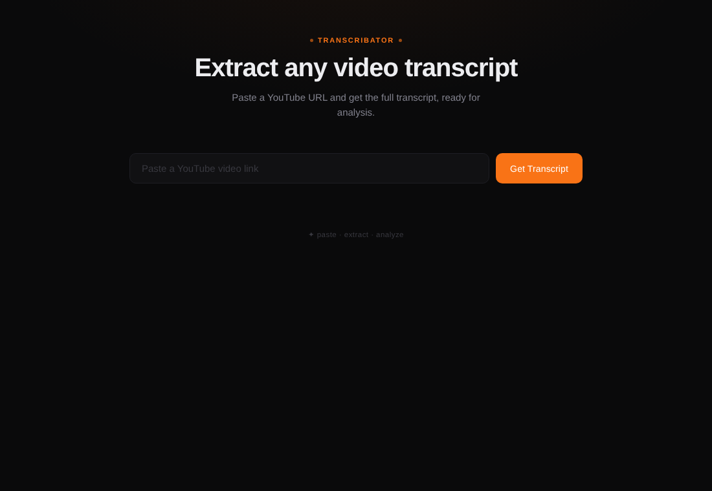

# Transcribator

A small web tool that turns a YouTube link into a transcript plus a ready-made analysis prompt, so you can decide in 30 seconds whether a video is worth watching.



## What it does and why

Long videos and podcasts are expensive to watch and cheap to summarize badly. The workflow here:

1. Paste a YouTube link into the page.
2. The backend fetches the video title (YouTube oEmbed) and the transcript ([Supadata](https://supadata.ai) API).
3. The page shows the transcript and builds a single block of text: a system prompt followed by the transcript.
4. One click copies that block (or copies the raw transcript only), ready to paste into any LLM chat. The "Copy & Open Claude" button copies and opens Claude.

The bundled prompt (`system_prompt_transcribator.txt`, written in Russian) makes the model return a quick verdict first (genre, filler percentage, what is new, watch/skip) and then only the substantive points, with timestamps when available. Swap the file to change the behavior; no code changes needed.

Each request also saves the combined text to `transcripts/` as a `.txt` file named after the video title.

## Stack

- Python 3.12, FastAPI, Uvicorn
- Supadata API for transcripts, YouTube oEmbed for titles
- Single-file vanilla HTML/CSS/JS frontend (`index.html`, no build step)
- Docker

## Run locally

```bash
python -m venv .venv && source .venv/bin/activate
pip install -r requirements.txt
pip install requests          # imported by server.py
export SUPADATA_API_KEY=your_key_here
python server.py              # http://localhost:8000
```

- `SUPADATA_API_KEY` is read in `server.py`. Without it the page loads, but transcript requests fail with a 502.
- `PORT` is optional (default `8000`).
- Health check: `GET /health`.

API: `POST /api/transcript` with JSON `{"url": "https://www.youtube.com/watch?v=..."}` returns `{"title", "transcript", "clipboard_text"}`.

## Docker

```bash
docker build -t transcribator .
docker run --rm -p 8000:8000 -e SUPADATA_API_KEY=your_key_here transcribator
```

The container runs as a non-root user and writes saved transcripts to `/app/transcripts`.

## Project layout

```
server.py                        FastAPI app (entry point): page, /health, POST /api/transcript
yt_transcript.py                 URL parsing, filename helpers, and a standalone CLI using youtube-transcript-api
api.py                           Older alternative API (GET /api/transcript via youtube-transcript-api); not used by Docker
index.html                       Frontend
system_prompt_transcribator.txt  Prompt prepended to every transcript
Dockerfile, requirements.txt
docs/screenshot.png
```

## Notes

This is a personal utility, not a hardened public service: the API has no authentication or rate limiting, so do not expose a deployment that holds a paid Supadata key to the open internet without putting those in front of it.
